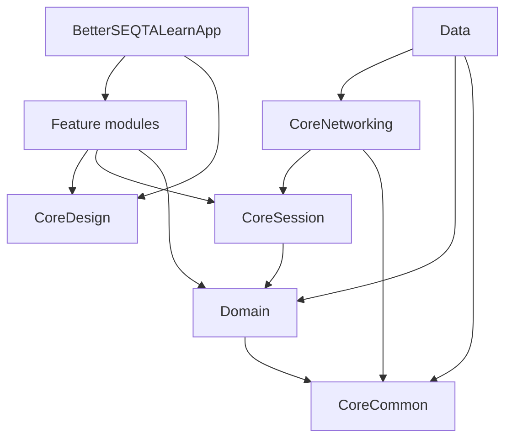

# Architecture

## Layers (SwiftPM)

## Dependency rules

1. **Domain** — models, repository protocols, use cases. No SwiftUI, no URLSession.
2. **CoreCommon** — `AppResult`, shared errors, formatters.
3. **CoreSession** — `SessionData`, `LearnSession`, Keychain store (Phase 1).
4. **CoreNetworking** — `learnSeqtaPOST`, `SeqtaStudentClient`.
5. **Data** — parsers, DTOs, repository implementations; depends on fixtures in tests only.
6. **CoreDesign** — theme, glass, motion; no Domain networking.
7. **Feature\*** — SwiftUI screens; depend on Domain + CoreDesign + session abstractions.
8. **BetterSEQTALearnApp** — `@main`, root navigation, environment objects.

## Navigation (target)

Match Android `MainShell`: authenticated stack with **drawer** + **five bottom tabs** (Home, Timetable, Courses, Tasks, Messages). Drawer opens Portals, Notices, Settings. Messages tab shows unread badge.

Implementation: `NavigationStack` + custom glass tab bar + sheet/drawer for menu (Phase 4).

## Testing

| Target | Role |
|--------|------|
| `DomainTests` | Model invariants |
| `DataTests` | JSON fixture parsers (Phase 1) |
| `FeatureTests` | Optional UI smoke (later) |

## Bundle & schemes

- Bundle ID: `org.betterseqta.learn`
- xtool product: `BetterSEQTALearn` → target `BetterSEQTALearnApp`
