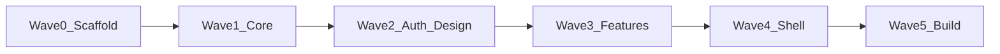

# Subagent orchestration

## Golden rule

At most **one** agent per wave runs compile/device commands (`xtool dev`, `xtool build`, root `swift build`, `xcodebuild`).

## Forbidden in parallel

- `xtool dev`, `xtool build`, `xcodebuild`, full root `swift build`
- `gradle*`, long Playwright suites
- Interactive `xtool setup`

## Allowed

- Read sibling repos outside `Sources/`
- `swift test --filter <Suite>` on one module (≤120s)
- Targeted parser work with fixtures under `Tests/Fixtures/`

## Waves

## Ownership (no merge conflicts)

| Agent | Owns |
|-------|------|
| A0-scaffold | `Package.swift`, `docs/*`, `xtool.yml`, app entry |
| A1-networking | `CoreNetworking`, `CoreSession` |
| A1-data | `Data`, `Tests/DataTests` |
| A1-domain | `Domain`, `Tests/DomainTests` |
| A2-design | `CoreDesign` |
| A2-auth | `FeatureAuth` |
| A3-* | Individual `Feature*` modules |
| A4-shell | `BetterSEQTALearnApp` navigation |
| A5-build | `scripts/verify-swift-tests.sh`, full test run |

## Handoff

Append **Done / Blocked** to [AGENT_STATUS.md](AGENT_STATUS.md) with files touched and test filters run.

## Prompt snippet

> Do not run `xtool dev`, `xtool build`, or root `swift build`. Run at most `swift test --filter <YourTests>` if needed. Output symbols must use `Learn*` / `BetterSEQTALearn*` only in `Sources/`.
